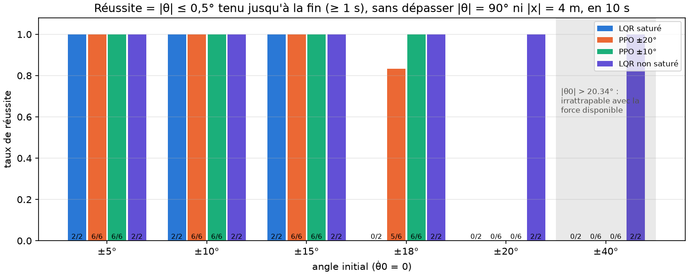
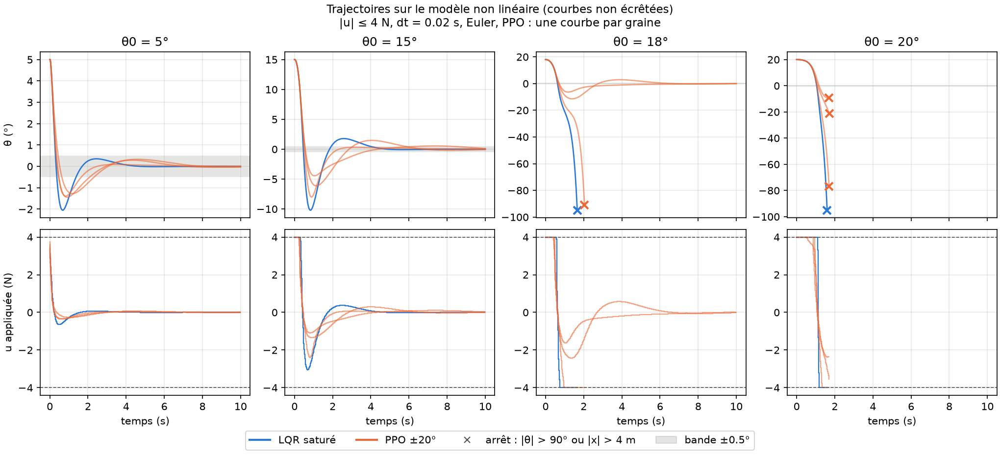
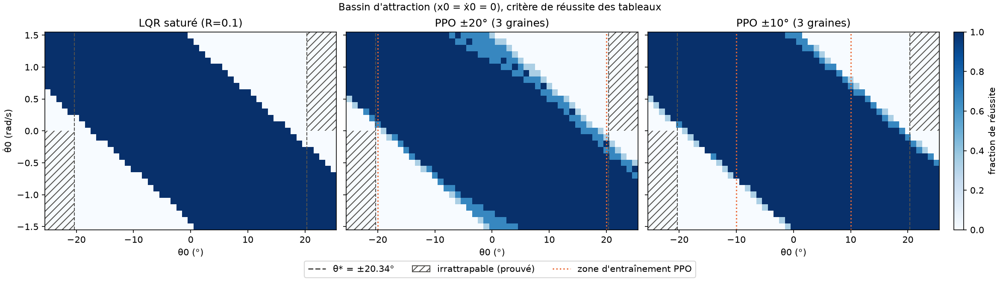
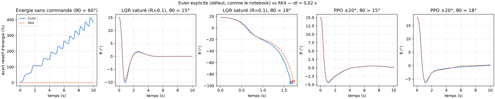
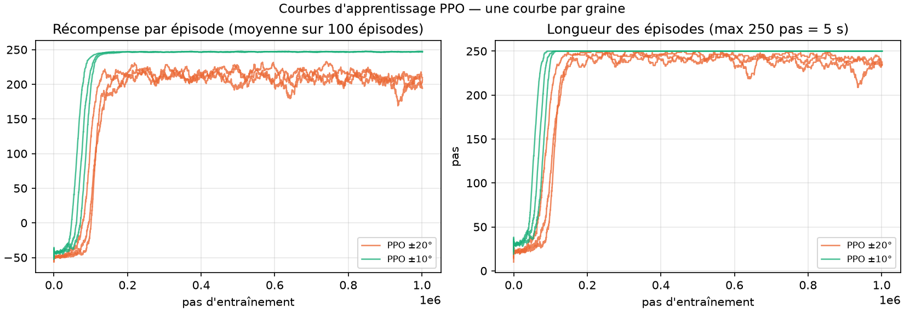

# Stabilisation d'un pendule inversé : commande LQR et apprentissage par renforcement (PPO)

Projet d'initiation à la recherche (PIR), **Master 1 Mathématiques — parcours ACSYON**,
Université de Limoges, 2025-2026 : *« Robustesse des algorithmes d'apprentissage par
renforcement — stabilisation d'un pendule inversé : commande LQR vs PPO »*.

- **Équipe** : Gevorg Andreasyan, Hicham Habchane, Khadijetou Soumare, Mouhamed Ndiaye
- **Encadrant** : Thibault Liard

Ce dépôt reprend le notebook du projet ([`archive/PIR-2.ipynb`](archive/PIR-2.ipynb), conservé
tel quel) sous forme de code organisé, testé et reproductible. Il compare un régulateur LQR et
un agent PPO **dans des conditions identiques** : même simulateur, même pas de temps, même
saturation de la force, mêmes états initiaux et mêmes critères de réussite. Les diapos de
soutenance sont dans [`docs/`](docs/).

**En bref** (4 N de force maximale, 10 s de simulation, 3 graines PPO) :

- Avec 4 N, **aucun contrôleur ne peut redresser un pendule lâché au-delà de 20,34°**. Cette limite physique est démontrée et vérifiée par un test : les échecs à 20° et 40° ne disent donc rien de l'algorithme utilisé.
- Le LQR de référence ($R = 0{,}1$) échoue dès 18° **à cause de la saturation, pas de la linéarisation** : le même gain sans saturation stabilise jusqu'à 40°. Avec $R \ge 0{,}3$, le LQR saturé tient aussi 18°.
- PPO entraîné sur ±20° stabilise 18° dans 5 essais sur 6 ; entraîné seulement sur ±10°, il stabilise 15° et 18° dans 6 essais sur 6. PPO se stabilise plus lentement que le LQR, mais avec moins d'énergie de commande.
- Les temps de stabilisation des diapos (0,3 à 0,7 s) mesuraient un *premier passage* sous 0,5°. Avec un critère de bande tenue, ils valent **1,4 à 6,5 s**.

## Sommaire

- [Problème et modèle](#problème-et-modèle)
- [Commande LQR](#commande-lqr)
- [Agent PPO](#agent-ppo)
- [Protocole d'évaluation](#protocole-dévaluation)
- [Résultats](#résultats)
- [Discussion et limites](#discussion-et-limites)
- [Reproduire les résultats](#reproduire-les-résultats)
- [Structure du dépôt](#structure-du-dépôt)

## Problème et modèle

Un chariot de masse $M$ roule sans frottement sur un rail. Une masse ponctuelle $m$ est fixée
au bout d'une tige sans masse de longueur $l$. On commande la force horizontale $u$ appliquée au
chariot, et l'objectif est de maintenir le pendule vertical ($\theta \to 0$).

État : $s = [x, \dot x, \theta, \dot\theta]$, avec $\theta = 0$ en position haute et $\theta > 0$
quand le pendule penche vers $+x$. Les équations du mouvement (Lagrange) s'écrivent :

$$
(M+m)\ddot x + m l\,\ddot\theta\cos\theta - m l\,\dot\theta^2\sin\theta = u,
\qquad
l\,\ddot\theta + \ddot x\cos\theta = g\sin\theta .
$$

| Paramètre | Valeur |
|---|---|
| $M$, $m$, $l$, $g$ | 1 kg, 0,1 kg, 0,5 m, 9,81 m/s² |
| Saturation de l'actionneur | $\lvert u\rvert \le 4$ N |
| Pas de commande | $\Delta t = 0{,}02$ s (50 Hz), force constante sur chaque pas |
| Intégrateur | Euler explicite (comme le notebook) ; RK4 en option |

Tous les paramètres sont dans [`config.yaml`](config.yaml), la **source unique** du projet. Une
copie est sauvegardée avec chaque modèle entraîné.

**Linéarisation.** Autour de $s = 0$, on obtient $\dot s = A s + B u$ avec

$$
A = \begin{pmatrix} 0 & 1 & 0 & 0 \\ 0 & 0 & -\frac{mg}{M} & 0 \\ 0 & 0 & 0 & 1 \\ 0 & 0 & \frac{(M+m)g}{Ml} & 0 \end{pmatrix},
\qquad
B = \begin{pmatrix} 0 \\ \frac{1}{M} \\ 0 \\ -\frac{1}{Ml} \end{pmatrix}.
$$

Les valeurs propres de $A$ sont $0, 0, \pm 4{,}646$ : la position haute est instable. La
matrice de Kalman $[B, AB, A^2B, A^3B]$ est de rang 4 : le système est commandable.

**Limite physique due à la saturation.** Pour un pendule lâché sans vitesse,

$$\ddot\theta = \frac{(M+m)\,g\sin\theta - u\cos\theta}{l\,(M + m\sin^2\theta)} .$$

Si $\tan\theta_0 > u_{max} / ((M+m)g)$, alors $\ddot\theta > 0$ quelle que soit la commande
$\lvert u\rvert \le u_{max}$. Avec 4 N, cela donne $\theta^* = 20{,}34°$ : **au-delà de cet
angle (et avec $\dot\theta_0 \ge 0$), aucun contrôleur ne peut redresser le pendule**. Cette
limite est vérifiée par un test unitaire.

## Commande LQR

Le retour d'état $u = -Ks$ minimise $J = \int_0^\infty (s^\top Q s + R u^2)\,dt$, avec
$K = R^{-1}B^\top P$, où $P$ est solution de l'équation de Riccati
$A^\top P + PA - PBR^{-1}B^\top P + Q = 0$.

Réglage de référence (diapos 9-10) : $Q = \mathrm{diag}(1, 0, 10, 0)$ (l'angle compte dix fois
plus que la position) et $R = 0{,}1$. On obtient

$$K = [-3{,}16;\ -4{,}25;\ -38{,}75;\ -8{,}22],$$

et les valeurs propres de $A - BK$ valent $-5{,}04 \pm 1{,}99i$ et $-1{,}06 \pm 1{,}00i$. Ces
valeurs sont vérifiées par les tests. Le LQR est ensuite appliqué au **modèle non linéaire**,
échantillonné à 50 Hz, avec la même saturation à 4 N que l'agent PPO.

## Agent PPO

Il s'agit de l'algorithme PPO de [Stable-Baselines3](https://stable-baselines3.readthedocs.io/),
avec une politique MLP. L'environnement est [`src/pendule/env.py`](src/pendule/env.py), vérifié
par `gymnasium.utils.env_checker.check_env`. Il reprend celui du notebook :

- **Observation** : $[x, \dot x, \theta, \dot\theta]$.
- **Action** : la force $u \in [-4, 4]$ N.
- **État initial** : $\theta_0 \sim \mathcal U(\pm \text{zone})$, $x_0, \dot x_0 \sim \mathcal U(\pm 0{,}05)$, $\dot\theta_0 \sim \mathcal U(\pm 0{,}1)$.
- **Fin d'épisode** : $\lvert\theta\rvert > 25°$ ou $\lvert x\rvert > 4$ m (*terminated*), ou 5 s, soit 250 pas (*truncated*).
- **Récompense** par pas : $r = 1 - 10\,\theta^2 - 0{,}1\,x^2 - 0{,}01\,u^2 - 0{,}5\,\dot\theta^2$, et $-50$ au pas qui fait sortir des limites.

| Hyperparamètre | Valeur | | Hyperparamètre | Valeur |
|---|---|---|---|---|
| `learning_rate` | 3·10⁻⁴ | | `gamma` | 0,99 |
| `n_steps` | 2048 | | `gae_lambda` | 0,95 |
| `batch_size` | 64 | | `clip_range` | 0,2 |
| `n_epochs` | 10 | | `ent_coef` | 0,01 |
| `total_timesteps` | 10⁶ | | `vf_coef` | 0,5 |

Deux expériences sont menées, chacune avec **3 graines** :

- **zone ±20°**, comme dans les diapos ;
- **zone ±10°**, pour mesurer la généralisation à des angles rattrapables mais jamais vus à l'entraînement (15° et 18°).

## Protocole d'évaluation

Il est le même pour tous les contrôleurs (section `evaluation` de `config.yaml`) :

- **États initiaux** : $x_0 = \dot x_0 = \dot\theta_0 = 0$, $\theta_0 \in \{\pm5, \pm10, \pm15, \pm18, \pm20, \pm40\}°$.
- **Simulation** : 10 s, avec arrêt si $\lvert\theta\rvert > 90°$ (pendule tombé) ou $\lvert x\rvert > 4$ m (chariot hors du rail).
- **Temps d'établissement** : premier instant à partir duquel $\lvert\theta\rvert \le 0{,}5°$ **jusqu'à la fin** de la simulation, ce maintien devant durer au moins 1 s. Le notebook utilisait le *premier passage* sous 0,5°, qui compte comme « stabilisé » un pendule qui ne fait que traverser la verticale ; cette valeur reste calculée pour comparaison.
- **Réussite** : temps d'établissement défini. Les autres issues sont *non stabilisé* (resté dans les limites sans se stabiliser), *limites dépassées* ou *erreur numérique*.
- **Autres métriques** : dépassement, nombre de traversées de la verticale, $\lvert u\rvert$ max, $\int u^2\,dt$ et $\lvert x\rvert$ final.
- **PPO** : moyenne ± écart-type sur les 3 graines.

## Résultats

Tous les chiffres viennent de [`resultats/`](resultats/) et sont produits par les scripts
(voir [Reproduire les résultats](#reproduire-les-résultats)). Les angles $+\theta_0$ et
$-\theta_0$ sont regroupés : pour PPO, une case compte 3 graines × 2 signes = 6 essais. Les
moyennes ± écarts-types portent sur les essais réussis.

### Taux de réussite

| $\lvert\theta_0\rvert$ | 5° | 10° | 15° | 18° | 20° | 40° |
|---|---|---|---|---|---|---|
| LQR saturé ($R = 0{,}1$) | 2/2 | 2/2 | 2/2 | **0/2** | 0/2 | 0/2 |
| PPO ±20° | 6/6 | 6/6 | 6/6 | **5/6** | 0/6 | 0/6 |
| PPO ±10° (15° et 18° jamais vus) | 6/6 | 6/6 | 6/6 | **6/6** | 0/6 | 0/6 |
| LQR **non** saturé (borne idéale) | 2/2 | 2/2 | 2/2 | 2/2 | 2/2 | 2/2 |

À 20° et 40°, tous les échecs avec 4 N sont des *limites dépassées* : le pendule tombe.



### Performances quand la stabilisation réussit

| Contrôleur | $\lvert\theta_0\rvert$ | Temps d'établissement (s) | Dépassement (°) | $\int u^2\,dt$ (N²·s) | $\lvert x\rvert$ final (m) |
|---|---|---|---|---|---|
| LQR saturé | 5° | 1,38 | 2,05 | 0,92 | 0,00 |
| PPO ±20° | 5° | 2,10 ± 0,35 | 1,27 ± 0,23 | 0,70 ± 0,08 | 0,12 ± 0,10 |
| PPO ±10° | 5° | 2,02 ± 0,06 | 1,15 ± 0,16 | 0,73 ± 0,04 | 0,02 ± 0,01 |
| LQR saturé | 15° | 3,96 | 10,2 | 10,3 | 0,00 |
| PPO ±20° | 15° | 5,31 ± 2,57 | 5,71 ± 1,33 | 6,37 ± 0,69 | 0,14 ± 0,12 |
| PPO ±10° | 15° | 6,01 ± 0,33 | 5,92 ± 1,10 | 6,67 ± 0,40 | 0,02 ± 0,02 |
| PPO ±20° | 18° | 5,88 ± 2,37 | 9,17 ± 2,49 | 12,7 ± 2,4 | 0,36 ± 0,37 |
| PPO ±10° | 18° | 6,48 ± 0,55 | 11,8 ± 3,0 | 14,8 ± 2,8 | 0,03 ± 0,03 |
| LQR non saturé | 18° | 3,64 | 7,86 | 12,9 | 0,00 |

Le tableau complet (avec le nombre de traversées de la verticale et $\lvert u\rvert$ max) est
dans [`resultats/resume.csv`](resultats/resume.csv).



### Chiffres des diapos et chiffres recalculés

Pour le LQR, la méthode est la même ; seul le critère change. Pour PPO, les modèles sont
nouveaux : celui des diapos n'a pas été conservé. Chaque valeur est recalculée par
`scripts/comparer.py` ([`resultats/diapos_vs_recalcule.md`](resultats/diapos_vs_recalcule.md)) ;
pour PPO, il s'agit de la moyenne ± écart-type sur 3 graines, pour $+\theta_0$.

| Contrôleur | $\theta_0$ | Diapo 12 | Diapo 24 | 1er passage < 0,5° (recalculé) | Temps d'établissement (bande tenue) |
|---|---|---|---|---|---|
| LQR saturé | 5° | 0,31 s | 0,31 s | 0,30 s | **1,38 s** |
| LQR saturé | 15° | 0,44 s | 0,37 s | 0,46 s | **3,96 s** |
| LQR saturé | 18° | diverge | diverge | jamais | limites dépassées |
| PPO ±20° | 5° | — | 0,56 s | 0,38 ± 0,05 s | **2,03 ± 0,34 s** |
| PPO ±20° | 15° | — | 0,64 s | 0,53 ± 0,03 s | **5,33 ± 3,07 s** |
| PPO ±20° | 18° | — | 0,74 s | 0,69 ± 0,03 s | **5,94 ± 0,08 s** (2 graines sur 3) |
| PPO ±20° | 20° | — | 1,08 s (θ max 1628°) | 1,11 ± 0,06 s | limites dépassées (3/3) |

Le « 1,08 s » de la diapo 24 pour PPO à 20° correspond à un pendule qui traverse la verticale
puis tombe : c'est l'exemple qui montre que le premier passage n'est pas un temps de stabilisation.

### Réglage du LQR : balayage de $R$ (même $Q$, saturation 4 N)

| $R$ | 0,03 | **0,1** (diapos) | 0,3 | 1 | 3 | 10 |
|---|---|---|---|---|---|---|
| ±18° stabilisé | non | **non** | oui | oui | oui | oui |
| ±20° stabilisé | non | non | non | non | non | non |

Un LQR moins agressif sature moins longtemps et tient 18°. La conclusion des diapos, « PPO
stabilise 18° mais pas le LQR », ne vaut donc que pour le réglage $R = 0{,}1$.

### Bassin d'attraction

Grille : $\theta_0 \in [-25°, 25°]$ et $\dot\theta_0 \in [-1{,}5;\ 1{,}5]$ rad/s, avec
$x_0 = \dot x_0 = 0$ ; même critère de réussite que ci-dessus. Pour PPO, la couleur indique la
fraction des 3 graines qui réussissent. Part de la grille stabilisée : LQR saturé 62,2 %,
PPO ±20° 63,9 %, PPO ±10° 66,8 % (moyenne sur les graines).



### Euler explicite et RK4

Sans commande (pendule lâché à 60°, 10 s), Euler explicite fait **gagner 384 %** d'énergie à
un système qui devrait la conserver, contre −0,001 % pour RK4. En boucle fermée, l'effet est
faible : sur les 48 paires de simulations comparées (LQR et 3 graines PPO ±20°, 12 angles),
**aucune issue ne change**. Sur les 29 paires stabilisées, le temps d'établissement diffère de
moins de 0,1 s dans 22 cas, et de 0,58 s au plus. Voir [`resultats/euler_vs_rk4.csv`](resultats/euler_vs_rk4.csv).



### Apprentissage



Les agents ±20° n'atteignent pas toujours la fin de l'épisode : une partie des états initiaux
d'entraînement est très proche de la limite physique de 20,34°.

## Discussion et limites

**Ce qui change par rapport aux diapos**

1. **La saturation, pas la linéarisation, explique l'échec du LQR.** À 18°, le LQR demande
   12,2 N au lieu des 4 N disponibles. Sans saturation, le même gain stabilise le modèle non
   linéaire jusqu'à 40°.
2. **La limite à 20° est physique.** Au-delà de $\theta^* = 20{,}34°$ (avec $\dot\theta_0 \ge 0$),
   aucune commande de 4 N au plus ne peut redresser le pendule. L'échec de PPO à 20° et
   l'échec de tous les contrôleurs à 40° ne mesurent donc pas la qualité d'un algorithme.
   Dans le notebook, l'entraînement sur ±35° faisait partir environ 40 % des épisodes d'états
   irrattrapables.
3. **PPO contre LQR à 18° dépend du réglage.** PPO (5/6 et 6/6) fait mieux que le LQR des
   diapos ($R = 0{,}1$, 0/2), mais un LQR saturé avec $R \ge 0{,}3$ tient aussi 18°. Aucun des
   deux ne gère la saturation de façon explicite. Une commande qui la prend en compte (MPC,
   anti-saturation) serait la comparaison naturelle suivante.
4. **Les temps de stabilisation des diapos mesuraient un premier passage.** Avec une bande de
   ±0,5° tenue jusqu'à la fin, PPO met 2 à 6,5 s, contre 1,4 à 4 s pour le LQR quand celui-ci
   réussit. PPO stabilise plus lentement et laisse le chariot plus loin du centre (agent ±20°),
   mais consomme moins d'énergie aux petits angles.
5. **Généralisation.** L'agent entraîné uniquement sur ±10° stabilise 15° et 18° (6/6), jamais
   vus à l'entraînement, et centre mieux le chariot ($\lvert x\rvert$ final ≈ 0,02 m contre
   0,12 à 0,36 m pour ±20°). Sur ce problème, élargir la zone d'entraînement jusqu'à la limite
   physique n'apporte rien de mesurable.

**Limites de l'étude**

- **Intégration** : Euler explicite est conservé pour rester comparable au notebook. Il est
  très peu fidèle sans commande (dérive d'énergie), mais en boucle fermée il ne change aucune
  issue (voir plus haut). Près de la limite physique, le résultat devient sensible au schéma :
  avec RK4, le LQR saturé avec $R = 3$ tient 20°, alors qu'il échoue avec Euler.
- **Graines** : 3 graines par expérience ; les écarts-types donnent un ordre de grandeur, pas
  un intervalle de confiance. Une graine (±20°, graine 2) échoue à +18° mais réussit à −18°.
- **Un seul réglage** de récompense et d'hyperparamètres PPO, repris du notebook sans optimisation.
- **Simulation idéale** : pas de frottement, de bruit de mesure, de retard ni d'erreur de
  modèle. La robustesse à ces effets, qui était le sujet du PIR, reste à étudier avec ce cadre.
- **Évaluation** : angles initiaux avec vitesse nulle, plus une grille (θ0, θ̇0) ; le chariot
  part toujours de $x_0 = 0$.

## Reproduire les résultats

Avec Python ≥ 3.10 (résultats obtenus avec Python 3.14, sur CPU) :

```bash
git clone https://github.com/H-HABCHANE/pendule-inverse-ppo-lqr.git
cd pendule-inverse-ppo-lqr
python -m venv .venv && source .venv/bin/activate
pip install torch==2.14.1 --index-url https://download.pytorch.org/whl/cpu   # optionnel : PyTorch CPU, plus léger
pip install -r requirements.txt
pip install -e .
pytest                       # tests (quelques secondes)
```

Les évaluations utilisent les modèles de `runs/`, qui ne sont pas versionnés : il faut les
réentraîner (étape 1). Sans réentraîner, on peut évaluer le modèle fourni (zone ±20°, graine 0)
avec `python scripts/evaluer.py --modeles models/zone20`.

```bash
# 1. Entraînement : 3 graines × 2 zones × 10⁶ pas.
#    Une graine par processus (1 thread chacun) pour paralléliser.
for z in 20 10; do for s in 0 1 2; do
  OMP_NUM_THREADS=1 python scripts/entrainer_ppo.py --seed $s --zone $z > entr_z${z}_s${s}.log 2>&1 &
done; done; wait

# 2. Évaluation et synthèse
python scripts/evaluer.py  --modeles runs/zone20 runs/zone10     # -> resultats/evaluation.csv  (~10 s)
python scripts/comparer.py --modeles runs/zone20 runs/zone10     # -> resultats/*.csv, figures/
python scripts/bassin.py   --modeles runs/zone20 runs/zone10     # -> figures/bassin_attraction.png (~10 s)
python scripts/integrateurs.py --modeles runs/zone20             # -> figures/euler_vs_rk4.png
python scripts/debit_vecenv.py                                   # -> resultats/debit_vecenv.csv (~3 min)

# Vérification rapide (quelques minutes, résultats non significatifs)
python scripts/entrainer_ppo.py --seed 0 --timesteps 20000 --sortie runs/essai
```

**Durées mesurées** (ordinateur portable, 8 cœurs, sur secteur) : les 6 entraînements lancés
en parallèle ont pris chacun **34 à 36 min de calcul** (460 à 500 pas/s par processus).

**Environnements vectorisés** ([`resultats/debit_vecenv.csv`](resultats/debit_vecenv.csv)) :
un seul entraînement, 2048 transitions par mise à jour quel que soit `n_envs`.

| `n_envs` | 1 | 2 | 4 | 8 |
|---|---|---|---|---|
| `DummyVecEnv` (pas/s) | 1173 | 1447 | 1664 | 1797 |
| `SubprocVecEnv` (pas/s) | 894 | 1267 | 1704 | 1894 |

Le gain plafonne (×1,6) : la simulation du pendule coûte peu, et ce sont les mises à jour du
réseau qui dominent. Pour plusieurs graines, lancer un processus par graine est plus efficace
(≈ 2 800 pas/s cumulés avec 6 processus).

## Structure du dépôt

```
pendule-inverse-ppo-lqr/
├── config.yaml            # source unique des paramètres
├── requirements.txt       # versions épinglées
├── pyproject.toml         # rend src/pendule installable (pip install -e .) ; configuration ruff/pytest
├── src/pendule/
│   ├── config.py          # lecture et validation de config.yaml
│   ├── dynamique.py       # équations, Euler / RK4, linéarisation, limite physique
│   ├── env.py             # environnement Gymnasium
│   ├── lqr.py             # gain LQR (Riccati)
│   ├── simulation.py      # boucle fermée commune à PPO et LQR
│   ├── metriques.py       # temps d'établissement, dépassement, énergie, etc.
│   ├── ppo.py             # entraînement et chargement d'un agent
│   └── figures.py
├── scripts/
│   ├── entrainer_ppo.py   # --seed, --zone, --timesteps
│   ├── evaluer.py         # tous les contrôleurs, même protocole -> resultats/evaluation.csv
│   ├── comparer.py        # synthèse, tableau diapos/recalculé, figures
│   ├── bassin.py          # carte du bassin d'attraction
│   ├── integrateurs.py    # Euler vs RK4
│   └── debit_vecenv.py    # débit d'entraînement selon n_envs
├── notebooks/demo.ipynb   # démonstration (sorties vidées)
├── resultats/             # CSV produits par les scripts
├── figures/               # figures du README
├── models/zone20/seed_0/  # modèle PPO final (zone ±20°, graine 0, choisie à l'avance) et sa config
├── tests/
├── docs/                  # diapos de soutenance
└── archive/PIR-2.ipynb    # notebook d'origine, non modifié
```

## Licence

[MIT](LICENSE).
